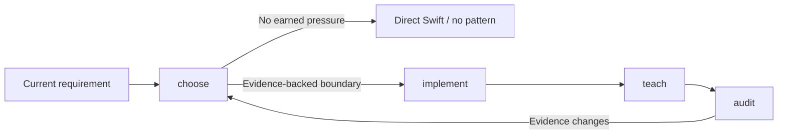

# Pragmatic Swift Pattern Skills


Portable Agent Skills for choosing, implementing, teaching, and auditing Swift design-pattern decisions from verified pressure.

[](LICENSE) [](skills/) [](upstream.lock.json)

> **Our position:** We are strongly in favor of design patterns when verified pressure moves responsibility to a better owner.
>
> We are against pattern quotas, diagram mimicry, and speculative overengineering.
>
> Direct Swift or no pattern are successful outcomes when they fit the evidence.

Read the complete [position on design patterns](docs/position.md).

These skills are the agent-facing companion to [Design Patterns in Swift](https://github.com/rgmez/Design-Patterns-in-Swift), the executable catalogue whose real-app examples, tests, diagrams, and decision reviews provide their evidence.

## Choose the smallest honest move



Accessible description: Begin with a current requirement, choose a direct Swift baseline or an evidence-backed pattern boundary, implement only the earned boundary, teach the verified result, and audit the catalogue; any stage can return to direct Swift when evidence does not support a pattern.

## Four focused skills

| Skill | Use it when | Do not use it for |
| --- | --- | --- |
| [`choose-swift-design-pattern`](skills/choose-swift-design-pattern/README.md) | A concrete Swift problem needs one reviewable verdict. | Generic pattern definitions or implementation. |
| [`implement-swift-design-pattern`](skills/implement-swift-design-pattern/README.md) | A named pattern has passed the evidence gate. | Choosing a pattern or speculative architecture. |
| [`teach-swift-design-pattern`](skills/teach-swift-design-pattern/README.md) | Verified code and tests need a decision-first guide. | Inventing missing evidence or changing architecture. |
| [`audit-swift-pattern-catalogue`](skills/audit-swift-pattern-catalogue/README.md) | A multi-pattern catalogue needs an evidence and release audit. | One feature-level pattern choice. |

## Living tools

Generated references keep the skills aligned with the upstream Swift catalogue, while human-authored instructions remain reviewable and never auto-merge.

The source catalogue remains independently useful: browse and run [Design Patterns in Swift](https://github.com/rgmez/Design-Patterns-in-Swift) when you need the full implementation, canonical guide, or behavioral tests behind a skill recommendation.

`upstream.lock.json` records the source commit, synchronization time, and generated reference paths; the daily workflow opens a reviewable PR when evidence changes, never an automatic merge.

See [Living evidence synchronization](docs/living-sync.md) for the allowlist, safety boundary, and manual workflow.

## Install

```sh
npx skills add rgmez/pragmatic-swift-pattern-skills --skill choose-swift-design-pattern
npx skills add rgmez/pragmatic-swift-pattern-skills --skill implement-swift-design-pattern
npx skills add rgmez/pragmatic-swift-pattern-skills --skill teach-swift-design-pattern
npx skills add rgmez/pragmatic-swift-pattern-skills --skill audit-swift-pattern-catalogue
```

Install all four for selected agents:

```sh
npx skills add rgmez/pragmatic-swift-pattern-skills --skill '*' --agent codex --agent claude-code --agent cursor --agent github-copilot
```

The verified project destinations intentionally reuse the shared Agent Skills location where the CLI supports it:

| Agent | CLI ID | Project destination |
| --- | --- | --- |
| Codex | `codex` | `.agents/skills/` |
| Claude Code | `claude-code` | `.claude/skills/` |
| Cursor | `cursor` | `.agents/skills/` |
| GitHub Copilot | `github-copilot` | `.agents/skills/` |

After installation, invoke the skill by name in the agent, for example: `Use $choose-swift-design-pattern for this requirement.`

## Validation

```sh
ruby scripts/validate_skills.rb
ruby scripts/sync_from_catalogue.rb --source ../Design-Patterns-in-Swift --check
npx --yes skills@1.8.1 add . --list
```

These checks validate package metadata, links, generated evidence, and CLI discovery; they do not claim runtime compatibility or adoption.

See the [validation record](docs/validation.md) for the tested surfaces, behavioral scenarios, and explicit limits of that evidence.

## Repository structure

```text
skills/                 Four portable Agent Skills and generated references
scripts/                Validation and upstream synchronization tools
assets/                 Repository editorial assets
upstream.lock.json      Evidence source commit and generated-file manifest
```

## License

MIT. See [`LICENSE`](LICENSE).
