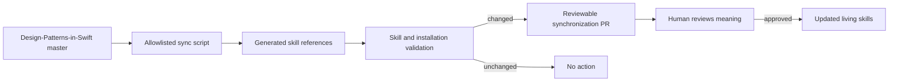

# Living Evidence Synchronization

The skills are living tools, but automation does not decide architecture.

## Source boundaries

- `rgmez/Design-Patterns-in-Swift` is the source of executable pattern evidence, decision matrices, catalogue reviews, README contracts, and hardening outcomes.
- This repository is the source of portable skill instructions, human documentation, validation, and distribution.

## Generated references

`scripts/sync_from_catalogue.rb` copies an explicit allowlist of upstream evidence into skill-local references and records the exact upstream commit in `upstream.lock.json`.

Every generated file contains its source path and commit. Generated Markdown links are rewritten to commit-pinned GitHub URLs so an installed skill keeps traceable evidence without depending on another local checkout.

## Automated workflow

The scheduled workflow:

1. Checks out both repositories.
2. Regenerates allowlisted references.
3. Runs repository and sync validation.
4. Stops when no evidence changed.
5. Pushes an automation branch when generated files changed.
6. Opens or reuses a pull request for human review.

It never rewrites `SKILL.md`, never auto-merges, and never publishes a release.



**Accessible description:** Changes on the pattern catalogue's master branch enter an allowlisted synchronization script. Generated references are validated. If nothing changed, the workflow stops. If evidence changed, it opens a pull request, and a person decides whether the living skills still tell the truth.

## Manual synchronization

```sh
ruby scripts/sync_from_catalogue.rb --source /path/to/Design-Patterns-in-Swift
ruby scripts/sync_from_catalogue.rb --source /path/to/Design-Patterns-in-Swift --check
```

Review generated diffs before adjusting human-authored skill instructions. A new upstream fact may require no instruction change, a narrow clarification, or a deliberate new release.
