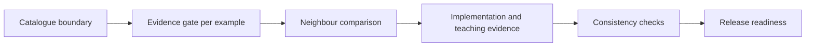

# Audit Swift Pattern Catalogue

<p align="center"></p>

Review a multi-pattern Swift catalogue as a decision system, not as a pattern-counting exercise.

> **Our position:** Strongly support patterns whose evidence moves responsibility to better owners; reject quotas, diagram mimicry, and speculative overengineering, including when direct Swift is the right catalogue outcome.

| Use it when | Do not use it for |
| --- | --- |
| A multi-pattern repository or teaching collection needs usefulness and release review. | Choosing one pattern for one feature or implementing fixes. |
| You need evidence, classification, consistency, and readiness findings. | Inflated counts, generic praise, or historical sketches treated as coverage. |



Accessible description: Establish the catalogue boundary, classify each example through the evidence gate, compare neighbours, inspect implementation and teaching evidence, check system consistency, and report release readiness with prioritized findings.

## Inputs

- Expected patterns, canonical guides, executable examples, and explicit no-pattern cases.
- Direct baselines, pressure evidence, implementations, tests, guides, diagrams, and status links.
- Target validators, warning-as-error builds, and relevant test commands when available.

## Outputs

- Per-pattern classifications: useful, useful with reservations, misclassified, unearned, or insufficient evidence.
- P0/P1/P2 findings with exact location, consequence, minimal correction, and verification step.
- Blocking defects, tooling limitations, optional polish, and release readiness.

## Example prompts

- `Audit this Swift pattern catalogue and separate blocking evidence defects from polish.`
- `Classify each canonical example by pressure, ownership, tests, and teaching completeness.`
- `Review release readiness without counting historical sketches or direct Swift as failures.`

## What it refuses

It refuses to require a shared framework or superclass, count historical sketches as canonical coverage, accept familiar diagrams as proof, or mutate code, branches, releases, or external systems.

## Synced evidence

- [`catalogue-guidance.md`](references/catalogue-guidance.md)
- [`catalogue-review.md`](references/catalogue-review.md)
- [`hardening-review.md`](references/hardening-review.md)
- [`example-quality-checklist.md`](references/example-quality-checklist.md)
- [`validate_catalogue_readmes.rb`](scripts/validate_catalogue_readmes.rb)

## Install

```sh
npx skills add rgmez/pragmatic-swift-pattern-skills --skill audit-swift-pattern-catalogue
```

Read the [skill instructions](SKILL.md) and the [repository overview](../../README.md).

## Source of truth

The upstream Swift catalogue remains the evidence source; this repository is the skill distribution source, with generated references pinned in `upstream.lock.json`.
