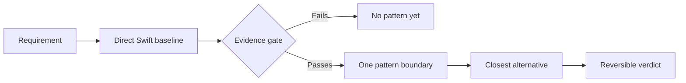

# Choose Swift Design Pattern

Make one evidence-backed architecture decision for a concrete Swift requirement.

> **Our position:** Strongly favor a pattern when verified pressure moves responsibility to a better owner; favor direct Swift or no pattern when it does not.

| Use it when | Do not use it for |
| --- | --- |
| A current requirement creates observable design pressure. | Generic pattern definitions or implementation. |
| You need one verdict: `Use`, `No pattern yet`, or `Insufficient evidence`. | Pattern quotas, diagram mimicry, or speculative growth. |



Accessible description: Frame the current requirement, establish the smallest direct Swift baseline, apply the evidence gate, compare one plausible neighbour, and return a reversible verdict; failed evidence exits to no pattern yet.

## Inputs

- Current behavior, owner, requirement, and observed pressure.
- Direct baseline and its named failure mode.
- Candidate pattern or enough symptoms to consult the pressure index and decision matrix.

## Outputs

- Observed pressure, direct baseline, one verdict, responsibility and cost.
- Verification checks, named competitor when supplied, closest alternative, and reconsideration signal.

## Example prompts

- `Evaluate whether this Swift feature has earned Strategy or should remain direct Swift.`
- `Choose one pattern for this observed ownership pressure and name the evidence gate.`
- `Review this proposal and return exactly Use, No pattern yet, or Insufficient evidence.`

## What it refuses

It refuses to invent pressure, return a pattern menu when one decision is supported, or implement a recommendation without an implementation request.

## Synced evidence

- [`pressure-index.md`](references/pressure-index.md)
- [`decision-matrix.md`](references/decision-matrix.md)
- [`catalogue-guidance.md`](references/catalogue-guidance.md)
- [`example-quality-checklist.md`](references/example-quality-checklist.md)

## Install

```sh
npx skills add rgmez/pragmatic-swift-pattern-skills --skill choose-swift-design-pattern
```

Read the [skill instructions](SKILL.md) for the operational contract and the [repository overview](../../README.md) for the shared position.

## Source of truth

The upstream Swift catalogue is the evidence source; this repository is the skill distribution source, with generated references recorded in `upstream.lock.json`.
