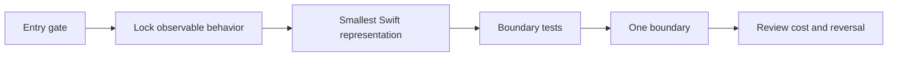

# Implement Swift Design Pattern

Turn one justified responsibility boundary into minimal Swift code and behavioral evidence.

> **Our position:** Strongly favor the earned boundary, not the textbook diagram; direct Swift remains the successful result when the evidence gate fails.

| Use it when | Do not use it for |
| --- | --- |
| A concrete requirement, baseline, failure mode, and pattern verdict already exist. | Choosing a pattern or adding speculative architecture. |
| Boundary tests can prove the moved responsibility. | Ceremonial participants, generic frameworks, or pattern quotas. |



Accessible description: Confirm the evidence gate, lock behavior, select the smallest Swift representation, test the boundary, implement one boundary, then review cost and the condition for reversal.

## Inputs

- Current requirement, direct baseline, named failure mode, and pattern verdict.
- Stable inputs, outputs, errors, ordering, ownership, lifetime, isolation, and cancellation.
- Existing test framework and repository organization.

## Outputs

- Minimal production boundary and behavior-focused tests.
- Representation choice, cost review, closest alternative, and reconsideration signal.

## Example prompts

- `Implement this approved Strategy boundary with the smallest Swift representation and tests.`
- `Turn this evidence-backed Observer decision into one boundary without ceremonial types.`
- `Add behavior tests for ownership, failure, and reversal before closing this pattern change.`

## What it refuses

It refuses to implement a named pattern that contradicts the requirements, invent unspecified errors or cancellation, preserve competing production architectures without a consumer, or add repositories, registries, containers, or generic frameworks without current pressure.

## Synced evidence

- [`evidence-gate.md`](references/evidence-gate.md)
- [`decision-matrix.md`](references/decision-matrix.md)
- [`swift-representations.md`](references/swift-representations.md)
- [`callback-to-async-boundary.md`](references/callback-to-async-boundary.md)
- [`implementation-checklist.md`](references/implementation-checklist.md)

## Install

```sh
npx skills add rgmez/pragmatic-swift-pattern-skills --skill implement-swift-design-pattern
```

Read the [skill instructions](SKILL.md) and the [repository overview](../../README.md).

## Source of truth

The upstream Swift catalogue supplies synchronized evidence; this repository distributes the skill instructions and generated references.
