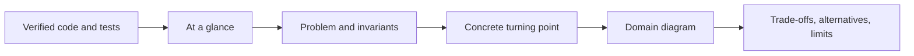

# Teach Swift Design Pattern

Turn verified Swift code and tests into a standalone guide that helps readers decide, not memorize.

> **Our position:** Teach the pressure and ownership boundary first, and name the pattern only when evidence earns it; direct Swift or no pattern is a valid conclusion.

| Use it when | Do not use it for |
| --- | --- |
| Verified code, relevant tests, and a current app requirement exist. | Choosing architecture or inventing missing implementation evidence. |
| A guide needs a direct baseline, turning point, diagram, and trade-offs. | Generic textbook definitions or architecture changes for editorial convenience. |



Accessible description: Start from verified implementation evidence, explain the current problem and invariants, show the concrete turning point, connect it to a domain diagram, and finish with trade-offs, alternatives, and limits.

## Inputs

- Verified code, relevant tests, current requirement, and exact run commands.
- Direct baseline, pattern boundary, closest alternative, and known limitations.
- Source names, links, and any requested RG visual treatment.

## Outputs

- Standalone evidence-first guide with accessible Mermaid explanation.
- At-a-glance summary, trace, trade-offs, when-not-to-use guidance, concrete reversal signal, and source map.

## Example prompts

- `Teach this verified Swift pattern using the direct baseline and one real input trace.`
- `Write a mobile-friendly GitHub guide that explains why this boundary earned the pattern.`
- `Document the trade-offs, nearest alternative, exact tests, and when to remove this pattern.`

## What it refuses

It refuses to present prose-only pressure as verified, paste generic definitions, claim unmeasured guarantees, create participant classes merely to match a diagram, or impose RG asset paths on repositories that do not use that visual system.

## Synced evidence

- [`pattern-readme-template.md`](references/pattern-readme-template.md)
- [`readme-experience.md`](references/readme-experience.md)
- [`visual-style.md`](references/visual-style.md)

## Install

```sh
npx skills add rgmez/pragmatic-swift-pattern-skills --skill teach-swift-design-pattern
```

Read the [skill instructions](SKILL.md) and the [repository overview](../../README.md).

## Source of truth

The upstream Swift catalogue is the evidence source; this repository distributes the portable teaching skill and its synchronized references.
